<p align="center">
  
</p>

<h1 align="center">DNServ</h1>

<p align="center">
  Fast, filtered DNS for homes and small offices.<br>
  Blocklists, per-device rules, analytics and two-server failover, in one container you set up from the browser.<br>
  <a href="https://dnserv.dev"><b>dnserv.dev</b></a>
</p>

<p align="center">
  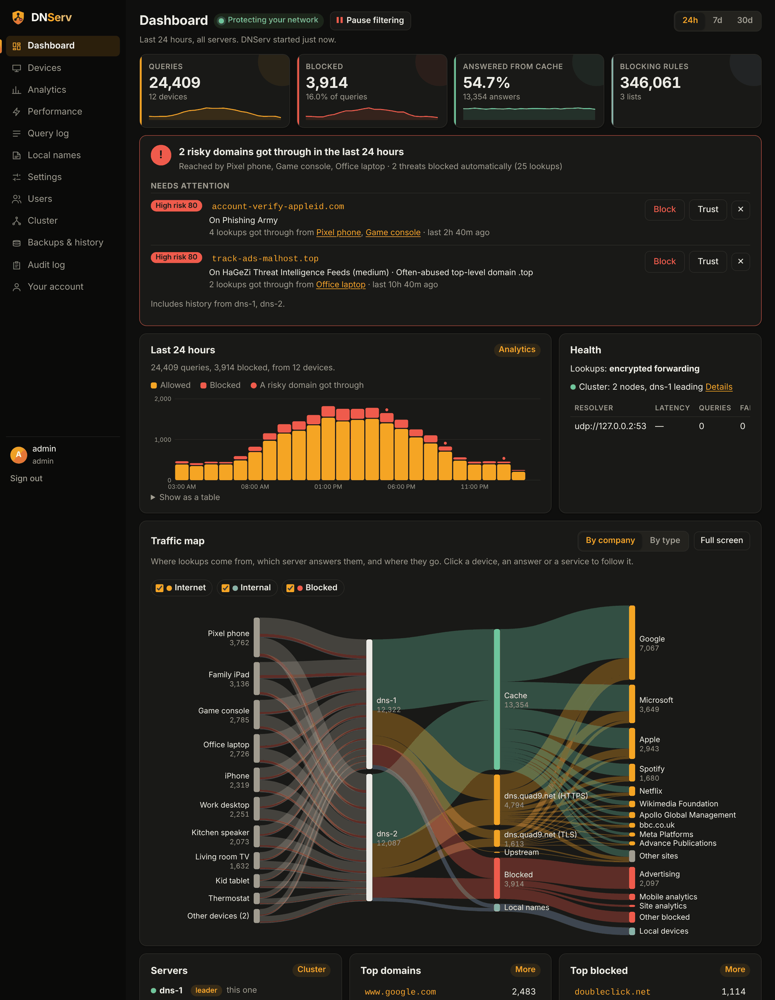
</p>

## Why DNServ

- **Fast.** About 51,000 queries a second on a 4-core machine, with a median answer of 0.14 ms. Popular names are prefetched before they expire, and old answers are served if the internet is down.
- **Blocks ads, trackers and malware.** Use any hosts file, domain list or AdGuard-style list (wildcards and regex included), plus your own allow and block rules.
- **Rules per device.** Put devices in groups like Kids, with their own blocked services, safe search, and schedules such as bedtime or homework time.
- **Shows what's going on.** Query log, analytics, response times and a traffic map from each device, through your servers, out to the services it reaches. History is kept for 30 days.
- **Spots threats.** Every lookup is scored against public malware and phishing feeds. The Dashboard tells you when something risky got through, who reached it, and lets you block it in one click. You can see and tune how scores add up.
- **Keeps working when a server fails.** Run two or more nodes. Settings stay in sync and any node can take over.
- **Private.** Uses encrypted DNS to Cloudflare by default, or resolves on its own with the bundled Unbound, optionally through a VPN.
- **Safe to run.** Two-factor sign-in is required for every account. Roles are admin, power user and viewer. Every change is in the audit log, and backups are encrypted.
- **No config files.** Pull the image, start it, and finish setup in the browser. You can import an existing AdGuard Home setup.

## Quick start

```bash
docker run -d --name dnserv --restart unless-stopped \
  -p 53:53/udp -p 53:53/tcp -p 853:853 -p 8080:8080 -p 8081:8081 \
  -v dnserv-data:/data ghcr.io/prezmc/dnserv:latest

docker logs dnserv 2>&1 | grep setup_code
```

You can also run `docker compose up -d` with the included [`docker-compose.yml`](docker-compose.yml).

Open `http://<server>:8080`, enter the setup code, and follow the wizard:

| | |
|---|---|
| 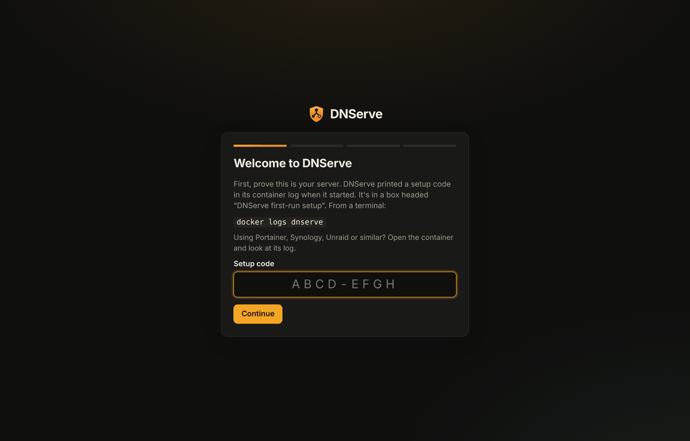<br>**1.** Enter the code from the log | 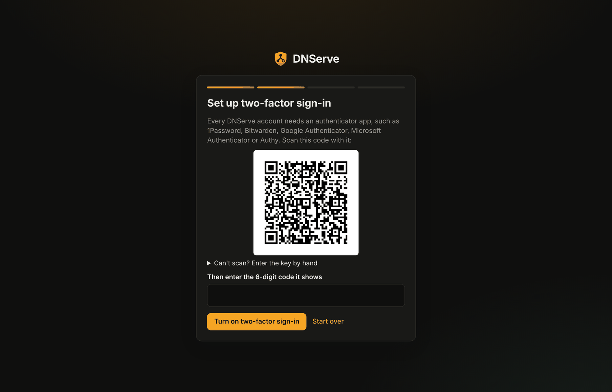<br>**2.** Create your account and scan the QR code |
| 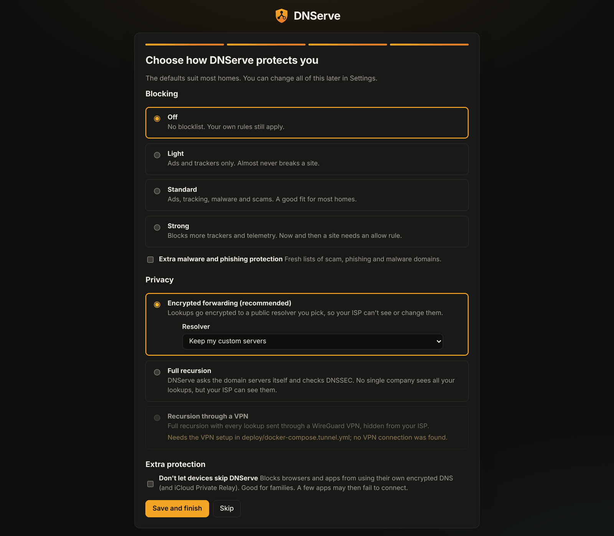<br>**3.** Pick how lookups leave your network, and your blocklists | 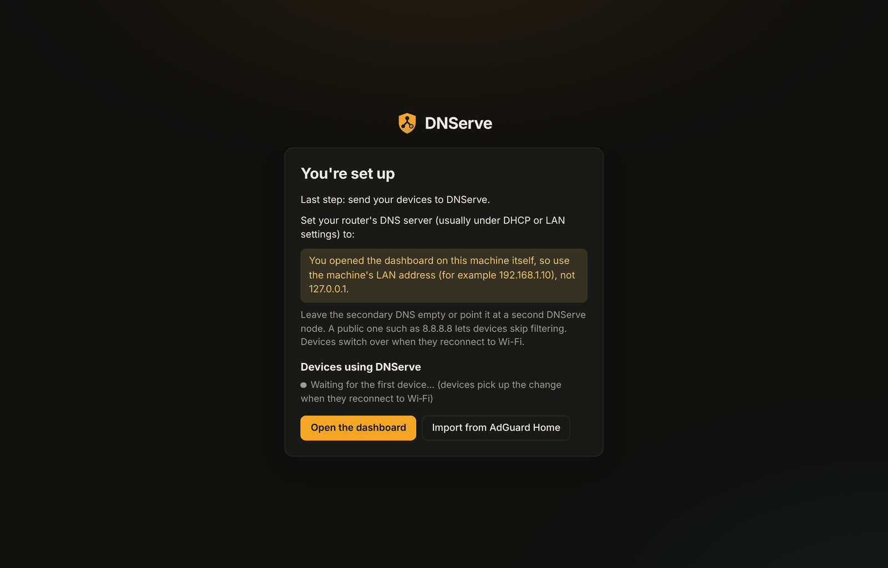<br>**4.** Point your router's DHCP DNS at the server |

Is port 53 already in use? See [Installing](docs/install.md) for systemd-resolved, non-root and reverse proxy notes.

**Updating:** run `docker compose pull && docker compose up -d`. Settings and history are kept. Coming from DNServe, the old name? See [Upgrading from DNServe](docs/install.md#upgrading-from-dnserve).

## A second server

1. Start the same image on another machine, with port 8081 open between the two.
2. On the first server, open **Cluster** and choose **Make a join code**.
3. On the new server, enter its setup code, choose **No, add this server to my DNServ**, and paste the join code.

Then add the second server as your router's second DNS server. To keep taking changes while either server is down, add a witness on a third machine. The [two-server guide](docs/deploy-two-servers.md) covers firewalls, upgrades, and what happens when something fails.

## Screenshots

| | |
|---|---|
| 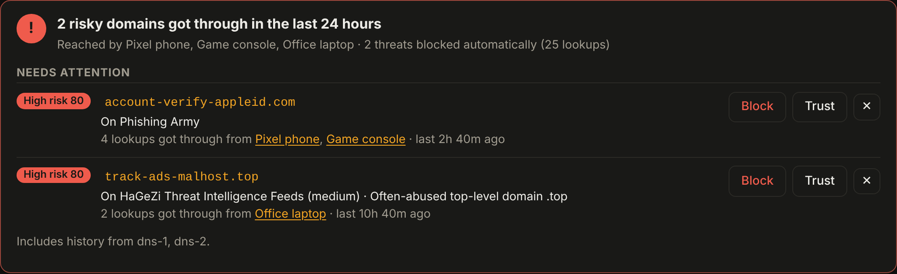<br>**Security** says whether anything risky got through, and who reached it | 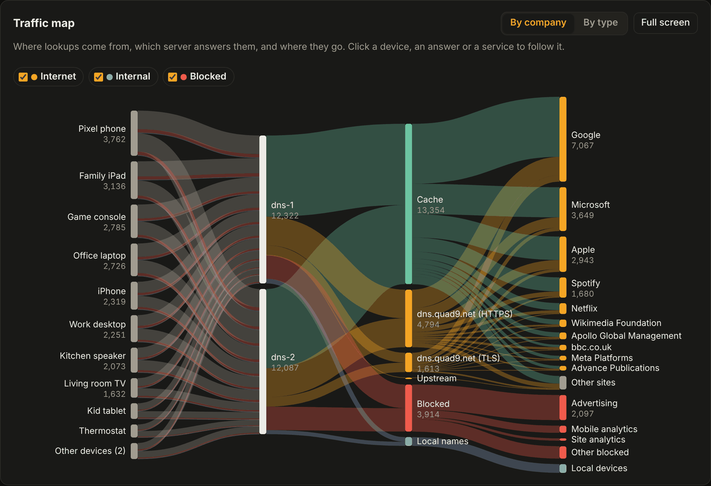<br>**Traffic map** follows lookups from devices to servers to services |
| 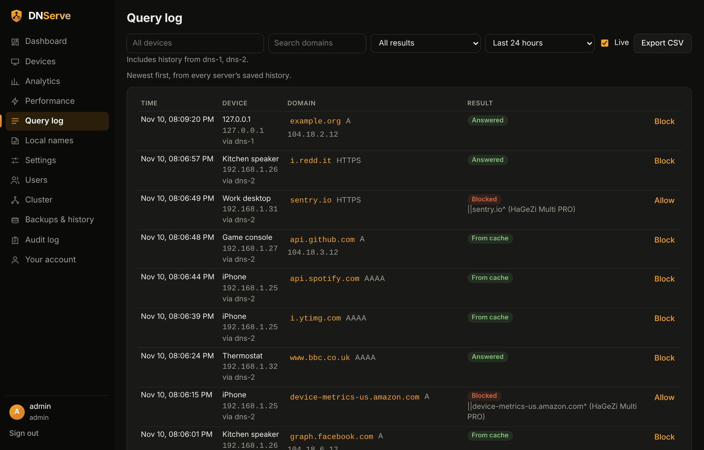<br>**Query log** searches every server's history | 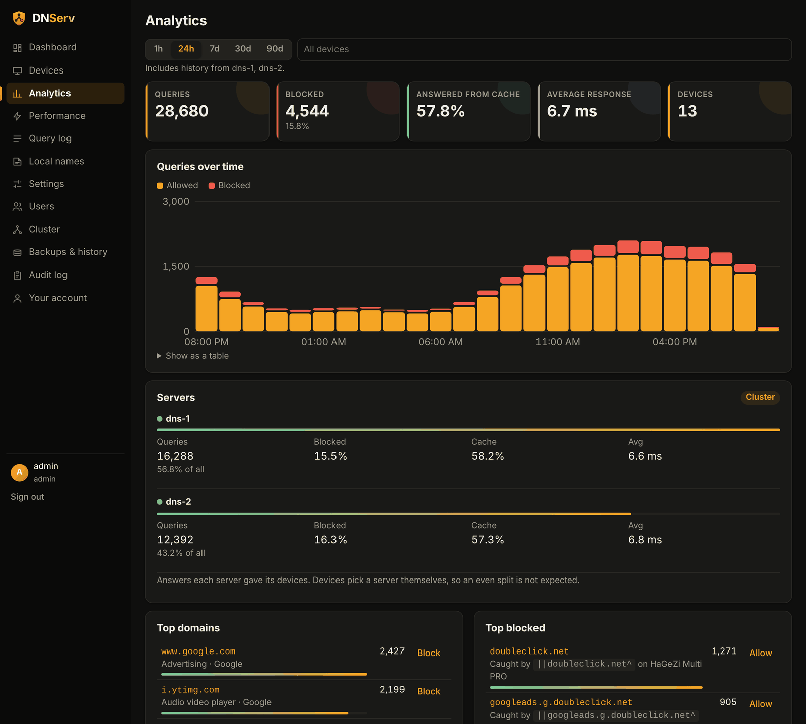<br>**Analytics** shows top domains, what blocked them, and busy devices |
| 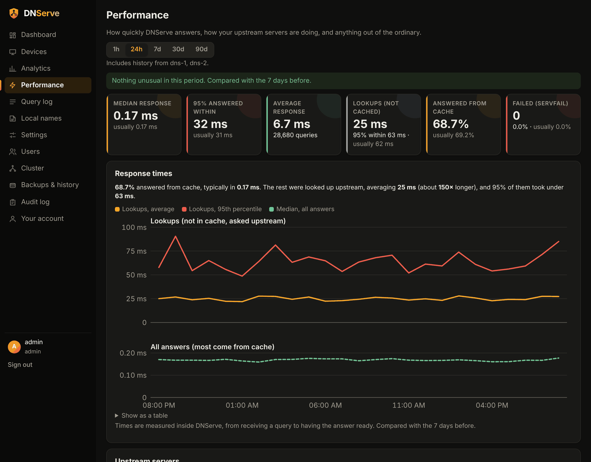<br>**Performance** shows response times, upstream health and anything unusual | 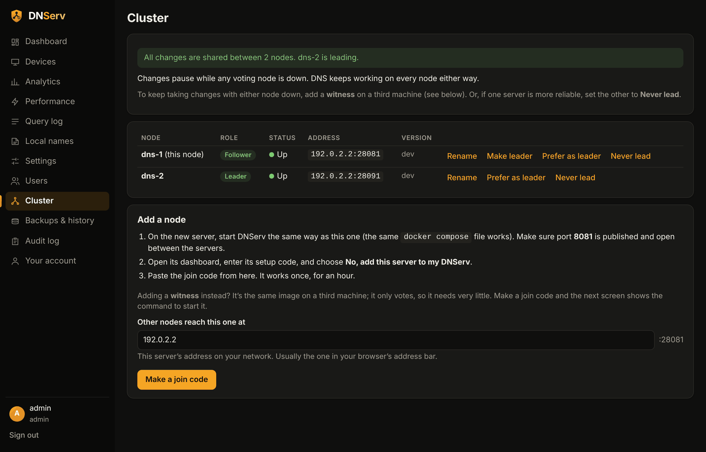<br>**Cluster** shows your nodes, with leader controls and join codes |
| 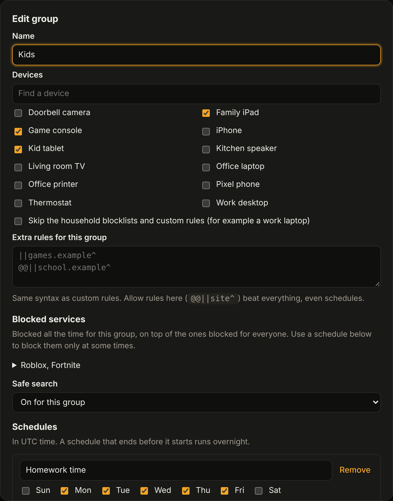<br>**Groups** have blocked services, safe search and schedules | 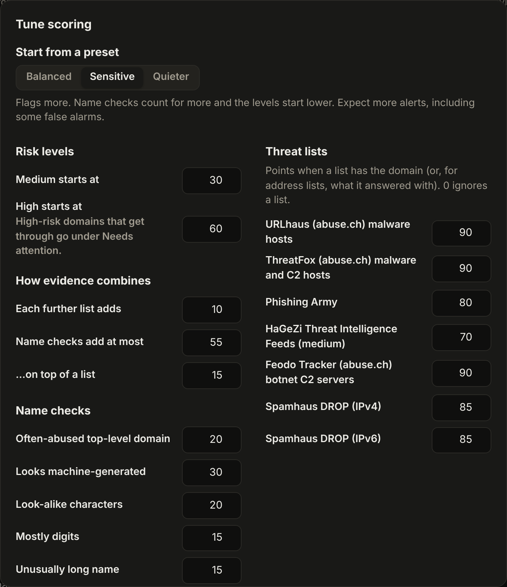<br>**Risk scoring** explains every score, with presets and a preview when you tune it |
| 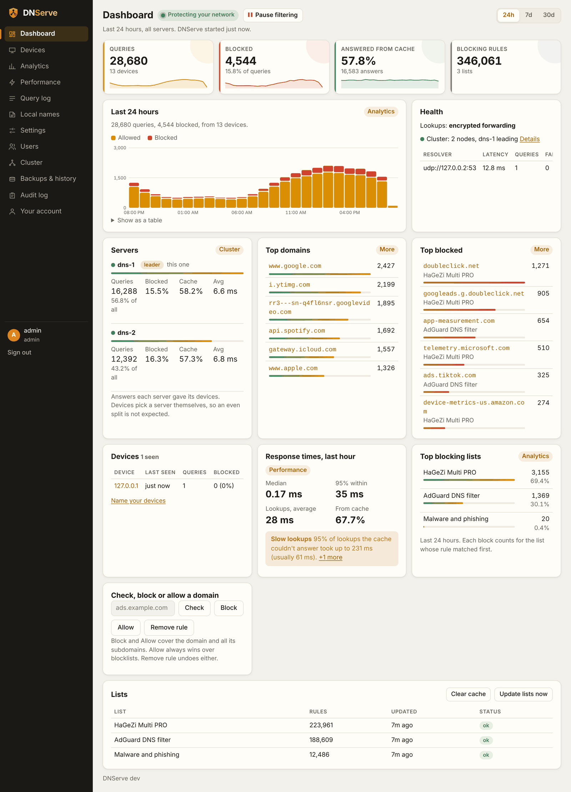<br>**Light theme**, which follows your system setting | |

## Documentation

| | |
|---|---|
| [Features](docs/features.md) | Everything DNServ does, in detail |
| [Installing and configuring](docs/install.md) | Ports, notes for some hosts, and environment variables |
| [Clustering](docs/clustering.md) | Nodes, witnesses, leader controls and recovery |
| [Two-server guide](docs/deploy-two-servers.md) | Step-by-step deploy and failure scenarios |
| [Two floating DNS addresses](docs/floating-dns-addresses.md) | More than two nodes behind keepalived |
| [Filtering](docs/filtering.md) | Rule syntax, blocked services, safe search, stopping bypass |
| [Security and risk scoring](docs/risk-scoring.md) | Threat feeds, the Security card, how scores add up, tuning |
| [Dashboard HTTPS](docs/https.md) | Self-signed, your own certificate, or one from Nginx Proxy Manager |
| [Backups and history](docs/backups.md) | Encrypted backups, schedules, restore |
| [Moving from AdGuard Home](docs/adguard-import.md) | What the importer brings across |
| [Tunnel mode](docs/tunnel-mode.md) | Recursive DNS through a WireGuard VPN |
| [Admin API](docs/api.md) | Endpoints, tokens, permissions, account recovery |
| [Performance](docs/performance.md) | Benchmarks and the `dnsbench` load tester |
| [Development](docs/development.md) | Building, tests and roadmap |
| [Testing](docs/testing.md) | Test layers, browser tests, the feature checklist and security scans |

## License

[Apache License 2.0](LICENSE).
