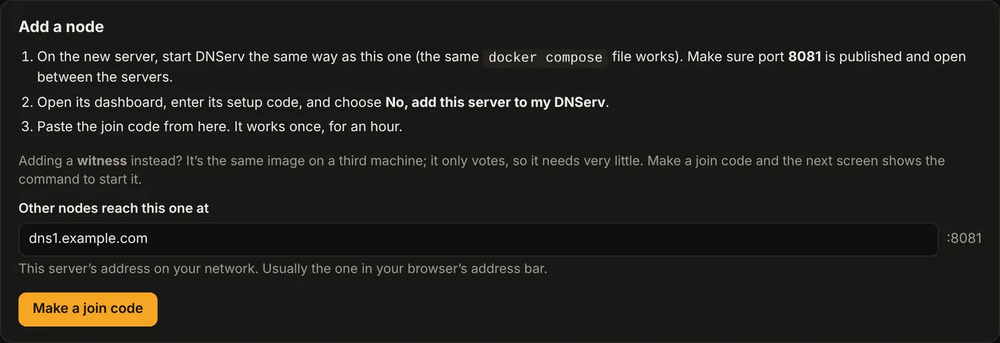
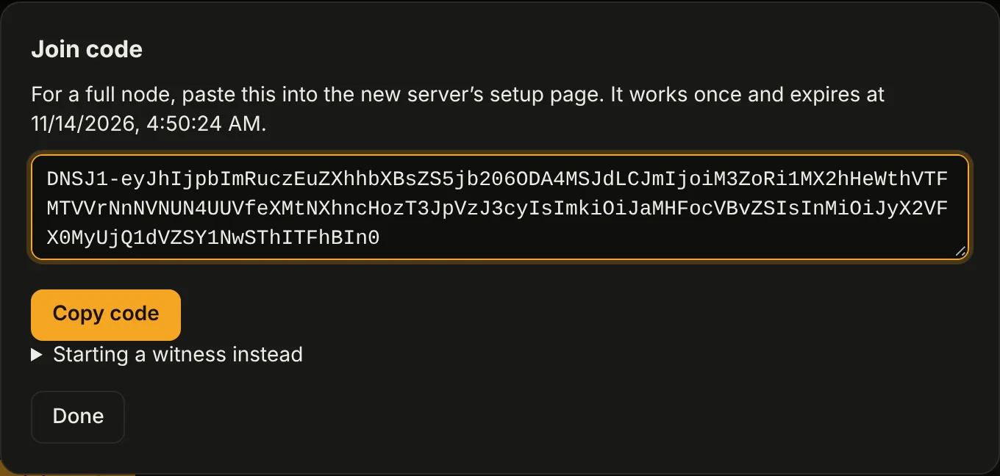
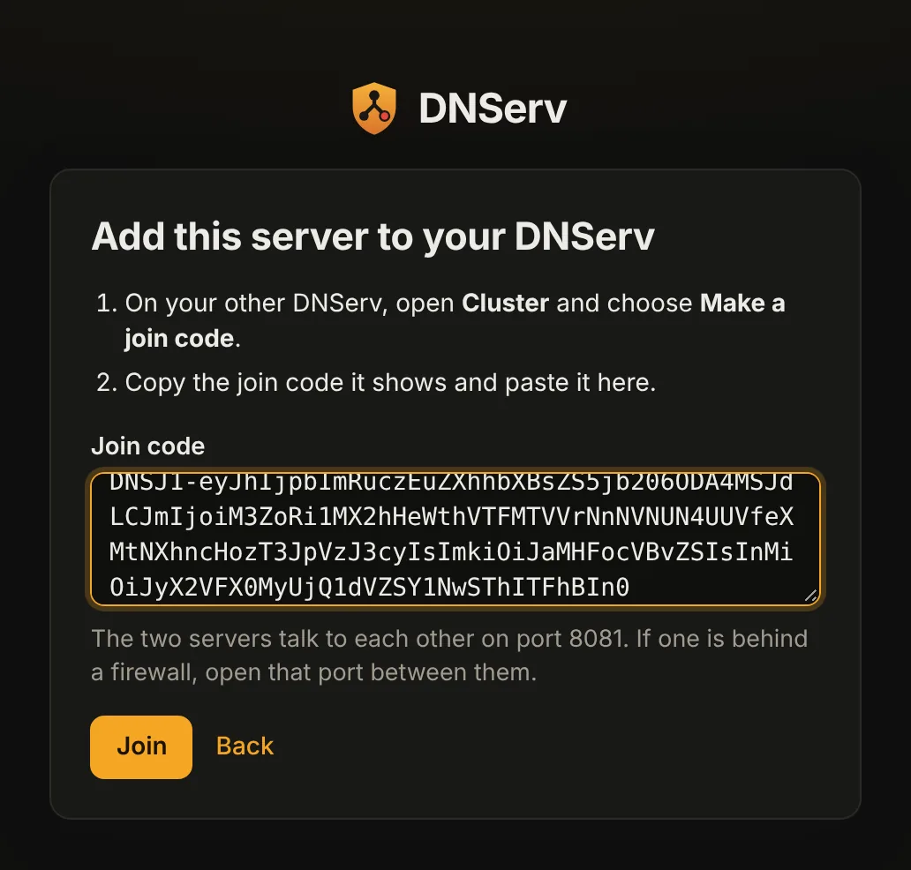
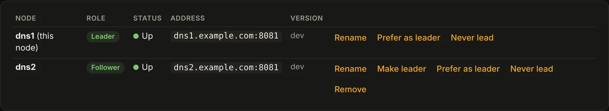
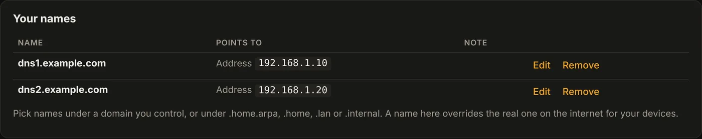
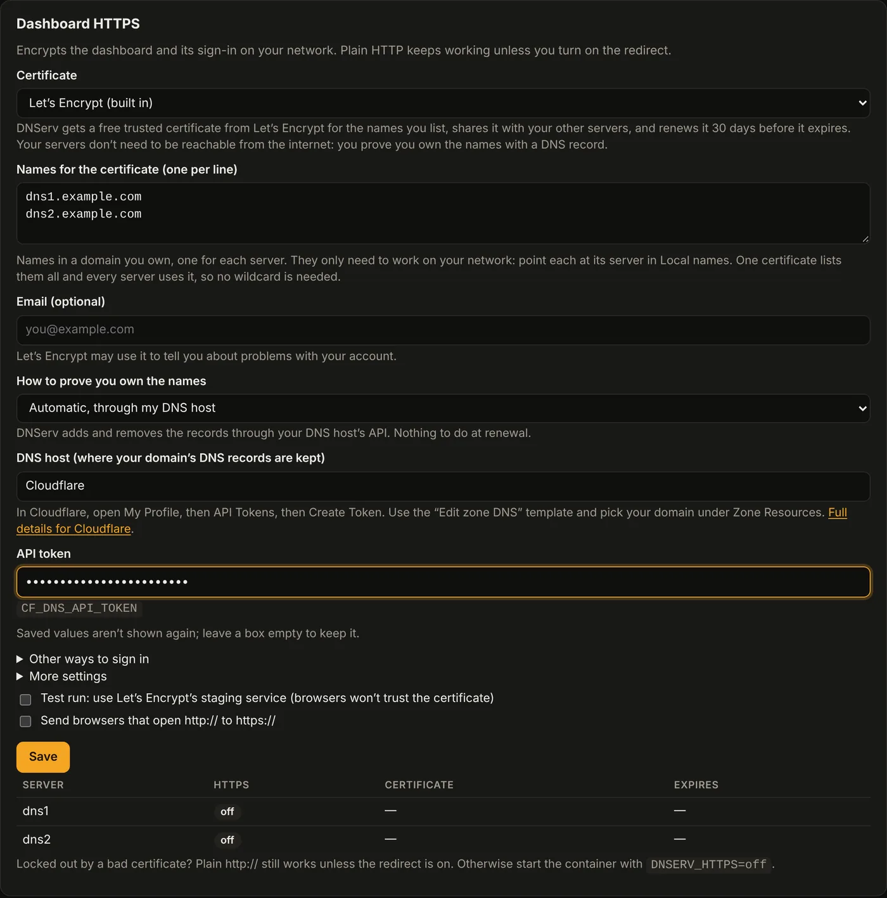
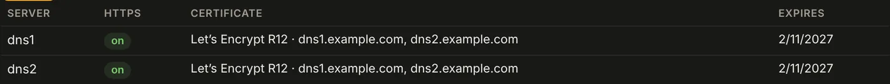

# Running DNServ on two servers

This guide sets up DNServ on two Linux servers, with an optional witness on a
third machine, and explains what happens when something breaks. Everything in
the "What happens when" table is checked by the failover tests in
[`test/failover`](../test/failover), which run on every pull request.

## What you need

- **Two Linux servers** (x86-64 or ARM64) with Docker and Docker Compose.
  They don't need to be big; DNServ answers tens of thousands of queries a
  second on a 4-core machine.
- **A fixed address for each**, set as a DHCP reservation on your router or
  configured on the server. Devices are given these addresses as their DNS
  servers, so they must not change.
- **Optional: a third machine for a witness** (a Raspberry Pi, a NAS that
  runs containers, any always-on box). It lets either server go down without
  pausing changes. Don't run it on one of the two DNS servers: if that
  server dies, the witness goes with it.

## Ports

| Port | Who needs to reach it | What for |
|---|---|---|
| 53 UDP and TCP | Your devices | DNS |
| 853 TCP | Your devices (optional) | DNS over TLS (Android Private DNS and others) |
| 443 TCP | You, and devices using DNS over HTTPS | Dashboard over HTTPS (`https://<name>/`) and DNS over HTTPS |
| 8080 TCP | You, from your own network | Dashboard and setup |
| 8081 TCP | The other DNServ server and the witness only | Keeping settings in sync. Encrypted and authenticated with the cluster's own certificates |

Don't expose any of these to the internet. If you use a firewall on the
servers (ufw shown, with your network as `192.168.1.0/24`):

```sh
sudo ufw allow from 192.168.1.0/24 to any port 53
sudo ufw allow from 192.168.1.0/24 to any port 853 proto tcp
sudo ufw allow from 192.168.1.0/24 to any port 443 proto tcp
sudo ufw allow from 192.168.1.0/24 to any port 8080 proto tcp
sudo ufw allow from 192.168.1.20 to any port 8081 proto tcp   # the other server
sudo ufw allow from 192.168.1.30 to any port 8081 proto tcp   # the witness
```

### Port 53 is already in use

On Ubuntu and some other distributions, systemd-resolved listens on port 53,
and DNServ can't start (`address already in use`). Turn off its listener and
point the server itself at a public resolver (or at the other DNServ):

```sh
sudo mkdir -p /etc/systemd/resolved.conf.d
printf '[Resolve]\nDNSStubListener=no\nDNS=1.1.1.1\n' | sudo tee /etc/systemd/resolved.conf.d/dnserv.conf
sudo ln -sf /run/systemd/resolve/resolv.conf /etc/resolv.conf
sudo systemctl restart systemd-resolved
```

## Set up

The example uses two servers at `192.168.1.10` and `192.168.1.20`, and the
names `dns1.example.com` and `dns2.example.com` in a domain you own.

### 1. Install DNServ on both servers

On each server, the [standard install](install.md#install):

```bash
mkdir -p ~/dnserv && cd ~/dnserv
curl -fsSLO https://raw.githubusercontent.com/prezmc/DNServ/main/docker-compose.yml
echo "TZ=America/Chicago" > .env
docker compose up -d
docker compose logs | grep setup_code
```

If a port is already taken on one server, set another one in that server's
`.env` (see [The .env file](install.md#the-env-file)). For the cluster
port, also set `DNSERV_CLUSTER_ADVERTISE` to that server's address and the
new port, for example:

```bash
DNSERV_CLUSTER_PORT=8091
DNSERV_CLUSTER_ADVERTISE=192.168.1.10:8091
```

Set `DNSERV_CLUSTER_ADVERTISE` too if the servers are on different
networks (two sites over a VPN, say), with the address the other server
uses to reach this one.

### 2. Set up the first server

Open `http://192.168.1.10:8080`, enter its setup code and follow the
wizard.

### 3. Join the second server

1. On the first server's dashboard, open **Cluster** and choose **Make a
   join code**. Check that "Other nodes reach this one at" is the first
   server's address (and port, if you changed it).

   

   

2. Open `http://192.168.1.20:8080`, enter its own setup code, choose **No,
   add this server to my DNServ**, and paste the join code.

   

A few seconds later the second server has the same accounts, settings and
blocklists, and both show as healthy on the Cluster page. From now on, sign
in to either one with the same account.



### 4. Witness (optional)

Make another join code. The dialog shows the command to run on the third
machine, or use
[`deploy/docker-compose.witness.yml`](../deploy/docker-compose.witness.yml)
with the code in `DNSERV_JOIN`.

### 5. Point your router at both

In your router's DHCP settings, set the DNS servers to the two addresses,
first server first. Devices pick up the change when they renew their lease
(reconnect to Wi-Fi to hurry one along). Remove any other DNS servers there,
or devices will use them to get around blocking.

### 6. Names and HTTPS (optional)

Everything works over plain HTTP at `http://<server>:8080`, which is how a
new install starts. Do this step only if you want each server to have a
name, a trusted certificate (a padlock in the browser) and passkey sign-in.

1. **Local names.** Under **Local names**, add `dns1.example.com` pointing
   at `192.168.1.10` and `dns2.example.com` pointing at `192.168.1.20`.
   They're shared, so both servers answer for both names.

   
2. **Certificate.** Under **Settings > Dashboard HTTPS**, choose **Let's
   Encrypt (built in)** and list both names. Pick your DNS host and paste
   its API token (for Cloudflare, one token). The leader asks for one
   certificate covering both names, usually within a minute, and both
   servers use it. See [Dashboard HTTPS](https.md#lets-encrypt-built-in).

   

   Once it's issued, the table under the form shows both servers using it:

   
3. **Check it.** Open `https://dns1.example.com` and
   `https://dns2.example.com`. Both should show a padlock with no warning.
   Once they do, you can tick **Send browsers that open http:// to
   https://**.
4. **Passkeys.** On each server, open it by name and add a passkey under
   **Your account > Passkeys**. A passkey only works on the server name it
   was made on, so you add one per server. See
   [Signing in](sign-in.md#with-more-than-one-server).

Bookmark both names. If one server is down, use the other.

## What happens when

Settings, rules and blocklists are the same on both servers. A change on
either one reaches the other within about a second, and the leader downloads
the blocklists for both, so both use the exact same version of each list.

DNS never waits for the other server: each one answers from its own copy of
the settings. In the failover tests, a client sending 50 queries a second to
each server got an answer to every query sent to a running server, in every
case below, with a typical answer in about 0.3 ms.

| What breaks | DNS | Changes (settings, rules, users) | What you do |
|---|---|---|---|
| One server goes down, with a witness | The other server answers. Devices move to it on their own | Keep working. If the leader was lost, the other server takes over in about 2 seconds | Start it again. It catches up within a second |
| One server goes down, no witness | The other server answers | Pause until it is back, unless the down server was set to **Never lead** | Start it again, or if it's gone for good, see below |
| The witness goes down | Unaffected | Keep working | Start it again |
| The link between the servers breaks | Both keep answering with the settings they had | Keep working on the side with the witness; pause on the other. Without a witness, pause on both | Fix the link. The cut-off server catches up straight away. Don't recover a server just because it can't see the other one |
| Both servers restart (power cut) | Each answers with its saved settings within a second of starting | Resume once both, or one and the witness, are up (about 2 seconds) | Nothing |
| A server is lost for good | The other server answers | Pause (no witness), or keep working (witness) | See below |

**How quickly devices switch.** When a DNS server stops answering, devices
retry the other one. How long that takes depends on the device, from about a
second to several seconds, and many devices then stay on the server that
answers for a while. To
make the switch instant, see
[floating DNS addresses](floating-dns-addresses.md).

### A server is lost for good

With a witness, nothing is urgent: changes keep working. Remove the lost
server under **Cluster** and add a replacement with a new join code.

Without a witness, changes are paused until you tell the surviving server
it's on its own: open **Cluster** on it and choose **Recover with this node
only**. It asks you to confirm, because it can't tell a server that is
switched off from a broken link. If the other server is in fact still
running, recovering both would leave two separate DNServs with different
settings. So only recover when you know the other one is off, broken or
wiped.

If the old server comes back anyway, it shows that it was left out, keeps
answering DNS with its old settings, and refuses to recover on its own. To
use it again, make a join code on the working server and use **Join another
DNServ** on the old one.

## Upgrading

Upgrade one machine at a time, so one server is always answering DNS:

1. The witness, if you have one.
2. The server that isn't leading (the Cluster page shows which one leads).
3. The leading server. The other one takes over while it restarts.

On each one run `docker compose pull && docker compose up -d`, then wait until
the Cluster page shows it as healthy before moving on. In the failover tests,
each node was back in under 2 seconds and no DNS query went unanswered.

Mixed versions are fine for the time an upgrade takes. Don't leave a cluster
on mixed versions for long.

## Try it on your own servers

After setting up, check failover yourself. From any computer on your
network (use `nslookup example.com <address>` on Windows):

1. `dig @<first server> example.com` and `dig @<second server> example.com`
   both answer.
2. On the second server run `docker compose stop`. `dig @<first server>
   example.com` still answers, and with a witness, a change on the first
   server's dashboard (add a rule, say) still saves.
3. `docker compose start` on the second server. Within a few seconds the
   Cluster page shows both healthy, and the change you made is on the second
   server too.
4. Repeat with the first server stopped.
5. On a phone, browse for a minute while one server is stopped, to see how
   your devices cope.

## Running the failover tests

The tests start real containers on a machine with Docker:

```sh
go test -tags failover -v -timeout 30m ./test/failover/
```

They build the image from this repository, or test another one with
`DNSERV_IMAGE=ghcr.io/prezmc/dnserv:latest`. `FAILOVER_REPORT=report.md`
writes the results table; `FAILOVER_KEEP=1` leaves the containers running for
a look afterwards.
