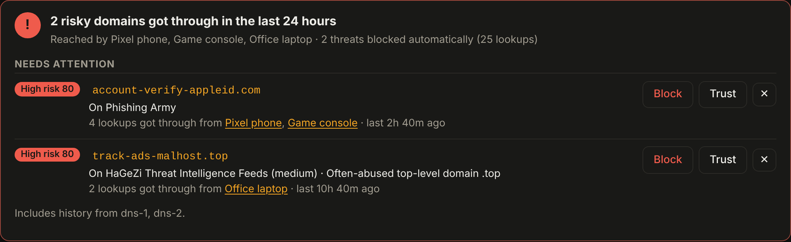
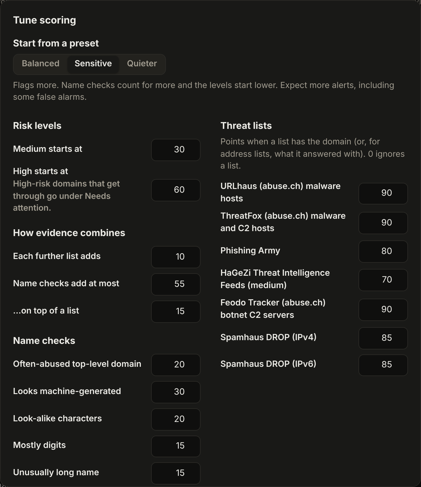

# Security overview and risk scoring

DNServ checks every domain your devices look up against public threat
feeds and a few checks on the name itself, and gives it a risk score from
0 to 100. **Scores never block anything.** They decide what the
Dashboard, Analytics and the Query log point out, so you can decide what
to block.

<p align="center"></p>

## What you see

- **Dashboard → Security.** A verdict for the period: "All clear: nothing
  risky got through", or how many high-risk domains your devices got
  answers for, who reached them, and how many threats were blocked anyway.
  **Needs attention** lists each one with why it's risky, the devices
  (each opens its Query log) and when, and three buttons:
  - **Block** blocks it and its subdomains for every device.
  - **Trust** marks it as a false alarm: it scores 0 from then on.
  - **Dismiss** hides it until a device reaches it again. Dismissals are
    shared by every server.

  The card also names any feed that isn't being checked (no abuse.ch key,
  or a failed download).
- **The queries chart** marks the hours when something risky got through.
- **Analytics → Risky domains** lists the riskiest domains seen, for
  everyone or one device.
- **Query log** shows a badge on risky lookups (hover for why) and filters
  by risk: low and above, medium and above, or high only. The CSV export
  follows the filter.
- **Domain details** show the score, the reasons and **how the score adds
  up**, or that the domain was checked and nothing was found.

## Where the data comes from

| Source | Lists | Default points |
|---|---|---|
| [URLhaus](https://urlhaus.abuse.ch/) (abuse.ch) | Malware hosts | 90 |
| [ThreatFox](https://threatfox.abuse.ch/) (abuse.ch) | Malware and command servers | 90 |
| [Phishing Army](https://phishing.army/) | Phishing sites | 80 |
| [HaGeZi Threat Intelligence Feeds](https://github.com/hagezi/dns-blocklists) (medium) | Malware, scams, command servers (covers subdomains) | 70 |
| [Feodo Tracker](https://feodotracker.abuse.ch/) (abuse.ch) | Botnet command server addresses | 90 |
| [Spamhaus DROP](https://www.spamhaus.org/drop/) | Hijacked or criminal networks | 85 |

URLhaus and ThreatFox need a free abuse.ch Auth-Key: sign in at
[auth.abuse.ch](https://auth.abuse.ch/), copy the key from your profile,
and paste it under **Settings → abuse.ch key**. The key is shared with
your other servers, never shown again and not part of backups.

Each server downloads the sources itself, keeps them in `/data/threat`,
and refreshes them twice a day (about 30 MB of memory). The lists are
matched on your own servers, so your lookups are never sent anywhere.
Turn the feeds off, or list trusted domains, under **Settings → Risk
scoring**.

## How a score adds up

1. The strongest list that has the domain sets the score (its points).
2. Each further list that has it adds 5.
3. Name checks add points: an often-abused top-level domain (15), a
   machine-generated look (25), look-alike international characters (15),
   mostly digits (10), an unusually long name (10). On their own they add
   at most 45, so a name alone reaches Medium at most; on top of a list,
   at most 10. Domains of companies in AdGuard's companies database skip
   the name checks.
4. The total is capped at 100.

Separately, when history is saved, each answer is checked: a domain that
answers with an address on Feodo Tracker or Spamhaus DROP, or is an alias
(CNAME) for a Medium-or-higher domain, gets that score if it is higher.

**Levels:** Low is 1 to 39, Medium 40 to 69, High 70 and up. High-risk
domains that get an answer go under Needs attention.

**Settings → Risk scoring → How risk scores work** shows all of this from
the numbers in force, so it stays right after you change them.

## Tuning

<p align="center"></p>

**Settings → Risk scoring → Tune scoring** (needs "Manage blocklists")
starts from a preset and lets you change every number:

| Preset | What it does |
|---|---|
| Balanced | The defaults above |
| Sensitive | Name checks count for more, further lists add 10, Medium starts at 30 and High at 60. More alerts, some false alarms |
| Quieter | Name checks count half, HaGeZi gives 65, Medium starts at 50 and High at 80. Only strong evidence makes a domain High |

Before you save, the dialog shows how many of the domains seen in the
last 7 days would be at each level, and which would rise or drop. The
scoring is a setting like any other: shared by every server, in settings
history and backups, and **Back to defaults** resets it. Scores are worked
out when they're shown, so a change applies to your whole history at
once, except the answer checks, which are scored as lookups happen.

In a config file:

```yaml
analytics:
  threat_feeds: true
  trusted_domains: [example.com]
  risk_scoring:
    feeds: {urlhaus: 90, threatfox: 90, phishingarmy: 80, hagezi-tif: 70, feodo: 90, drop4: 85, drop6: 85}
    corroboration: 5
    names: {tld: 15, generated: 25, lookalike: 15, digits: 10, long: 10}
    name_cap: 45
    name_cap_listed: 10
    medium: 40
    high: 70
```

Values left out keep their defaults; a feed at 0 is ignored.

## Also

- **On your lists.** A domain's details list every enabled blocklist with
  a rule for it.
- **VirusTotal.** Add your own free API key under Settings → VirusTotal to
  get a **Check on VirusTotal** button in domain details. Only the domain
  you click is sent, at most 4 a minute, and results are kept for a day.
- **Domain types.** Each domain's type and owner (Advertising · Google)
  come from AdGuard's companies database (CC BY-SA 4.0).

[Back to the README](../README.md)
