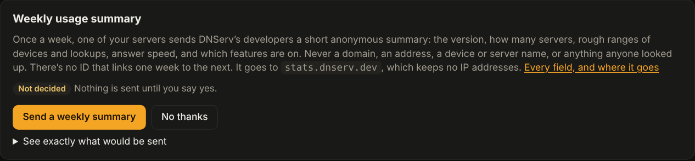

# Usage stats

DNServ can send its developers a short anonymous summary once a week, so
we can see how many people run it and how well it works. **It is off until
an admin says yes.** The setup wizard asks with two equal choices, neither
picked, and you can change your answer any time under **System → General → Weekly
usage summary**.

The totals are public at [dnserv.dev/stats.html](https://dnserv.dev/stats.html).

## What is sent

One summary a week per cluster, sent by the leader. This is everything in
it. **System → General → Weekly usage summary > See exactly what would be sent**
shows your own, and the last one sent is kept there too.

| Field | Example | What it is |
| --- | --- | --- |
| `schema` | `1` | The summary's format version |
| `report_id` | `9f2c…` | Random and new every week, so a retry isn't counted twice. Nothing links one week to the next |
| `week` | `2026-W46` | The ISO week |
| `version`, `channel` | `1.2.0`, `stable` | Which DNServ, and which update channel |
| `arch` | `amd64` | CPU type |
| `servers`, `witnesses` | `2`, `1` | How many of each the cluster has |
| `upstream_mode` | `forward` | `forward`, `recursive` or `tunnel` (never the servers' addresses) |
| `devices` | `11-50` | Devices seen in the last 7 days, as a range |
| `lookups_per_day` | `10k-100k` | Average over the last 7 days, as a range |
| `answer_ms_p50`, `answer_ms_p95` | `0.4`, `18` | Answer times over the last 7 days, in milliseconds |
| `cache_hit_pct`, `blocked_pct`, `failed_pct` | `71.2`, `9.1`, `0.3` | Shares of lookups over the last 7 days |
| `lists` | `6` | How many blocklists are on (not which) |
| `features` | `["https","backups"]` | Which features are on, from a fixed list: `https`, `backups`, `backups_s3`, `backups_smb`, `passkeys`, `groups`, `schedules`, `blocked_services`, `safe_search`, `block_bypass`, `local_names`, `query_history`, `threat_feeds`, `auto_updates` |

**Never sent:** domains or anything anyone looked up, IP addresses, device,
user or server names, host names, list or upstream addresses, any setting's
value, your time zone, or a lasting ID.

If a later version of DNServ adds a field, the summary's `schema` goes up
and DNServ asks again before sending it.

## Where it goes

Summaries go to `https://stats.dnserv.dev/v1/report`, a small
[Cloudflare Worker](../deploy/stats-worker/) whose code is in this
repository. It:

- never reads or stores the sender's IP address, and has request logging
  turned off. Cloudflare, which runs it, sees the address in passing like
  any website host would;
- keeps only the fields above, plus a country code from Cloudflare's own
  lookup. A country is shown publicly only when at least 5 clusters share
  it;
- deletes each summary after 90 days and keeps only the weekly totals;
- is readable only by the DNServ maintainer, through the Cloudflare
  account it runs in. Only totals are published.

## Turning it off

- **System → General → Weekly usage summary > Turn off.** Nothing more is sent.
- Or set `DNSERV_USAGE_REPORT=off` in a server's `.env`: that server never
  sends it, whatever the setting says.

Turning it on or off, and each summary sent, is in the audit log.

## Download numbers

The public page also shows numbers that need nothing from your server:
ghcr.io image downloads, GitHub release downloads, stars and repository
traffic, saved daily by the `Repo stats` workflow to `stats/downloads.csv`
on the `stats` branch.

## For the maintainer: setting up the receiver

1. Put `dnserv.dev`'s DNS on Cloudflare (free), or skip the custom name
   and use the Worker's `workers.dev` address (then change
   `usage.DefaultURL` and `site/stats.html` to match).
2. Create a Cloudflare API token from the **Edit Cloudflare Workers**
   template, adding **D1: Edit**.
3. In the repository's **Settings > Secrets and variables > Actions**, add
   the secrets `CLOUDFLARE_API_TOKEN` and `CLOUDFLARE_ACCOUNT_ID`, and the
   variable `STATS_DOMAIN` = `stats.dnserv.dev`.
4. Run **Actions > Usage stats receiver**. It creates the database the
   first time, then deploys. Later changes under `deploy/stats-worker`
   deploy on merge.
5. Optional, for repository traffic in the download numbers: add a
   fine-grained token for this repository with **Administration: read** as
   the secret `REPO_STATS_TOKEN`.
